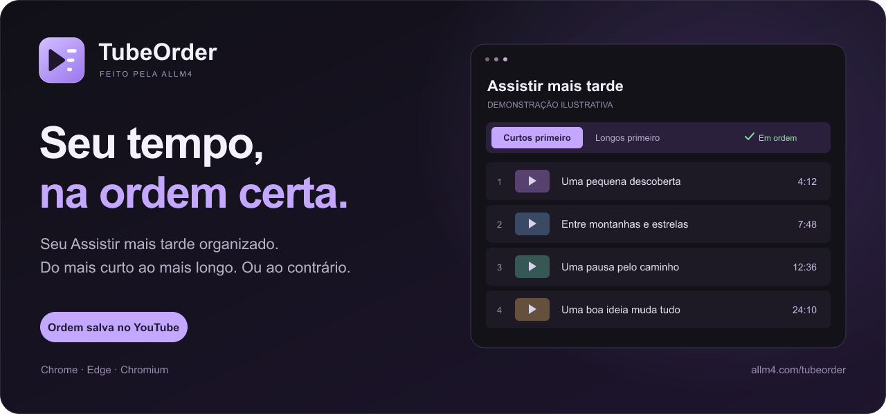

  

<h1 align="center">TubeOrder</h1>

  Seu <strong>Assistir mais tarde</strong> do YouTube, em ordem de duração. 
  Gratuito, em português, para Chrome, Microsoft Edge e navegadores Chromium compatíveis.

  <strong><a href="https://allm4.com/tubeorder/">Conhecer e experimentar</a></strong>
  &nbsp; · &nbsp;
  <strong><a href="https://github.com/Benfic4rthur/TubeOrder/releases/latest">Baixar a última versão</a></strong>
  &nbsp; · &nbsp;
  <a href="#instalação">Como instalar</a>

---

## Uma fila que acompanha seu tempo

Use **↓** para curtos primeiro ou **↑** para longos primeiro. O ícone do TubeOrder na faixa reaplica a última ordem. Cada controle explica sua ação ao passar o mouse. A sequência fica salva na própria playlist do YouTube, e a reprodução automática segue essa ordem.

| Recurso | Como funciona |
| --- | --- |
| **A lista inteira em ordem** | Carrega as próximas páginas e organiza por duração, sem um limite artificial de vídeos. |
| **Sua preferência lembrada** | Ao entrar no Assistir mais tarde, aplica a última regra escolhida. |
| **Reorganizar com um clique** | Reaplica a última regra sem precisar trocar entre curtos e longos. |
| **Adicionou enquanto assistia?** | Detecta a entrada de novos vídeos na fila lateral e organiza com a regra salva, sem recarregar o vídeo. |
| **Recomendado interessante?** | O botão **+ Mais tarde** salva o vídeo na sua conta com um clique, usando o comando nativo do YouTube. |
| **Também enquanto você assiste** | Funciona na playlist lateral dos vídeos abertos com `list=WL`. |
| **Controles simples** | Ícone para reorganizar, duas setas, ✓ verde ou × vermelho e Removidos, em uma única linha. |
| **Removeu sem querer?** | Abra Removidos no mesmo painel, reconheça o vídeo pela miniatura, título e canal e use Restaurar para devolvê-lo à sua conta. |
| **Progresso visível** | Exibe estimativa de tempo e bloqueia a página durante a organização, mantendo o vídeo e seus controles disponíveis. |
| **Trabalho só quando necessário** | Encerra o processamento ao terminar. Durante a reprodução, observa somente entradas e saídas de itens da fila, sem verificações periódicas. |

O tempo depende do tamanho da lista e das respostas do YouTube. Vídeos sem duração identificável ficam no final. É necessário estar conectado à sua conta do YouTube.

## Instalação

**[Baixe o ZIP na última release](https://github.com/Benfic4rthur/TubeOrder/releases/latest)**, extraia e guarde a pasta em um lugar fixo. O mesmo pacote serve para os dois navegadores.

| Microsoft Edge | Google Chrome / Chromium |
| --- | --- |
| Abra `edge://extensions` | Abra `chrome://extensions` |
| Ative **Modo do desenvolvedor** | Ative **Modo do desenvolvedor** |
| Clique em **Carregar sem compactação** ou **Carregar sem pacote** | Clique em **Carregar sem compactação** |

1. Selecione **a pasta extraída que contém `manifest.json`**. Se você clonou o repositório, selecione a pasta [`extension`](extension/).
2. Fixe o ícone do TubeOrder no menu de extensões e recarregue as abas do YouTube.
3. Abra o [Assistir mais tarde](https://www.youtube.com/playlist?list=WL). Na primeira utilização, o TubeOrder organiza dos mais curtos para os mais longos.

A distribuição é por ZIP; a extensão ainda não está nas lojas dos navegadores. **Não é necessário instalar Node.js, dependências ou um servidor para usar.** As atualizações também são manuais: substitua os arquivos na pasta instalada, clique em **Recarregar** no cartão da extensão e recarregue o YouTube.

## Assistiu? Você pode manter ou remover

Para remover quando quiser, use **Remover** em cada item do Assistir mais tarde, junto ao botão **Bloquear** quando o CanalNonGrato estiver instalado. O comando usa o próprio YouTube e só anuncia sucesso depois da confirmação do servidor e da atualização da lista. Também funciona com a remoção automática desligada.

**A remoção de assistidos vem ativada** e pode ser desligada no ícone da extensão. Ao terminar o vídeo ou avançar com **90% do progresso**, inclusive em um vídeo retomado, o TubeOrder espera o próximo da lista começar e mostra um aviso de **6 segundos** antes de remover o anterior. A regra de pelo menos **80% dos trechos reproduzidos na sessão** também continua valendo.

Clique em **Não apagar** para cancelar **somente aquela tentativa**. Se reassistir ao vídeo e avançar novamente, ele poderá receber outro aviso. Pausar o próximo vídeo interrompe a contagem; ao retomar, o prazo começa de novo. [Veja as regras completas](docs/guia.md#remover-vídeos-assistidos).

## Salvar um recomendado com um clique

Ao assistir a um vídeo pelo Assistir mais tarde, use **+ Mais tarde** nos recomendados abaixo da fila. O botão aparece junto ao nome do canal e salva na playlist real da sua conta. O TubeOrder só anuncia sucesso após a confirmação do YouTube. A entrada do vídeo na fila aciona a organização com a última regra escolhida.

Vídeos já presentes na fila ou identificados pelo YouTube como salvos ficam sem o botão. A extensão também oculta o botão quando encontra marcação de assistido ou progresso de reprodução, inclusive parcial. **O YouTube nem sempre informa o histórico completo nos recomendados:** se ele omitir essas marcações, um vídeo assistido anteriormente ainda poderá exibir o botão. O TubeOrder não consulta nem armazena seu histórico completo.

## Removidos: recupere uma exclusão acidental

Clique em **Removidos** ao lado do status da organização. O botão fica marcado em roxo claro, o título muda para **Removidos** e o mesmo espaço da playlist mostra as miniaturas, títulos, canais e durações dos vídeos removidos. Clique novamente para voltar ao **Assistir mais tarde**. A alternância não altera a playlist nem comanda a reprodução.

**Restaurar** devolve o vídeo ao Assistir mais tarde real da conta conectada. O registro só sai do histórico após a confirmação da inclusão pelo YouTube. Se o vídeo já aparecer na lista desta aba, não há outro pedido de inclusão e o registro é mantido para preservar a referência.

O histórico guarda **até 30 vídeos recentes por conta**, neste navegador, a partir desta versão. Registra as remoções manuais e automáticas do TubeOrder e os comandos nativos de remoção confirmados que a extensão consegue acompanhar na aba do Assistir mais tarde. Remoções antigas ou feitas em outras sessões/dispositivos sem a extensão ativa não podem ser recuperadas. Ao entrar o 31º removido, sai o mais antigo. A lista aberta atualiza assim que o YouTube confirma a remoção. O histórico não baixa nem guarda cópias dos vídeos.

## Leveza e privacidade

- O pacote instalado usa JavaScript, CSS e ícones locais, sem dependências de execução, analytics ou servidor próprio.
- A única permissão declarada é `storage`. Os scripts são carregados em `www.youtube.com`; as ações da playlist ficam restritas ao Assistir mais tarde.
- As preferências e o histórico de removidos ficam no navegador. O histórico contém identificação do vídeo, título, canal, duração, endereço da miniatura e data, separado por conta. Não guarda credenciais. As alterações na playlist são gravadas pelo próprio cliente do YouTube, com a sessão já conectada.
- Após a ordenação, os dados temporários são liberados. Na tela de reprodução, observadores restritos à fila e aos recomendados detectam entradas de vídeos e atualizações relevantes dos cards. Não há verificações periódicas; animações de miniaturas e mudanças fora desses blocos são ignoradas. Com a remoção opcional ligada, o acompanhamento usa eventos nativos do vídeo ativo.
- O TubeOrder não baixa vídeos nem guarda cópias. Mudanças na interface do YouTube podem exigir atualizações da extensão.
- A lista de removidos é carregada somente quando aberta, guarda os 30 mais recentes e usa imagens sob demanda. Ao fechar, libera os dados da visualização. A gravação usa o service worker apenas durante os pedidos, sem consultas periódicas.

Consulte o [manifesto](extension/manifest.json), o [código da extensão](extension/) e o [guia de funcionamento](docs/guia.md).

## Para quem quer olhar por dentro

| Diretório | Conteúdo |
| --- | --- |
| [`extension/`](extension/) | Extensão instalável e ícone oficial. |
| [`tests/`](tests/) | Testes de ordenação, reprodução e remoção cancelável, com páginas simuladas. |
| [`scripts/`](scripts/) | Verificação, geração dos ícones e empacotamento do ZIP. |
| [`docs/`](docs/) | Guia de uso, desenvolvimento e publicação de versões. |

**[Desenvolver e testar](docs/desenvolvimento.md)** · **[Publicar uma versão](docs/publicacao.md)** · **[Relatar um problema](https://github.com/Benfic4rthur/TubeOrder/issues)**

As releases alimentam os downloads do site automaticamente: versão, tamanho e pacote pertencem à mesma release estável. Em caso de falha na consulta, o site leva à página da última release.

---

  Feito pela <a href="https://allm4.com/">ALLM4</a>. 
  Projeto independente, sem vínculo com YouTube, Google ou Microsoft.

